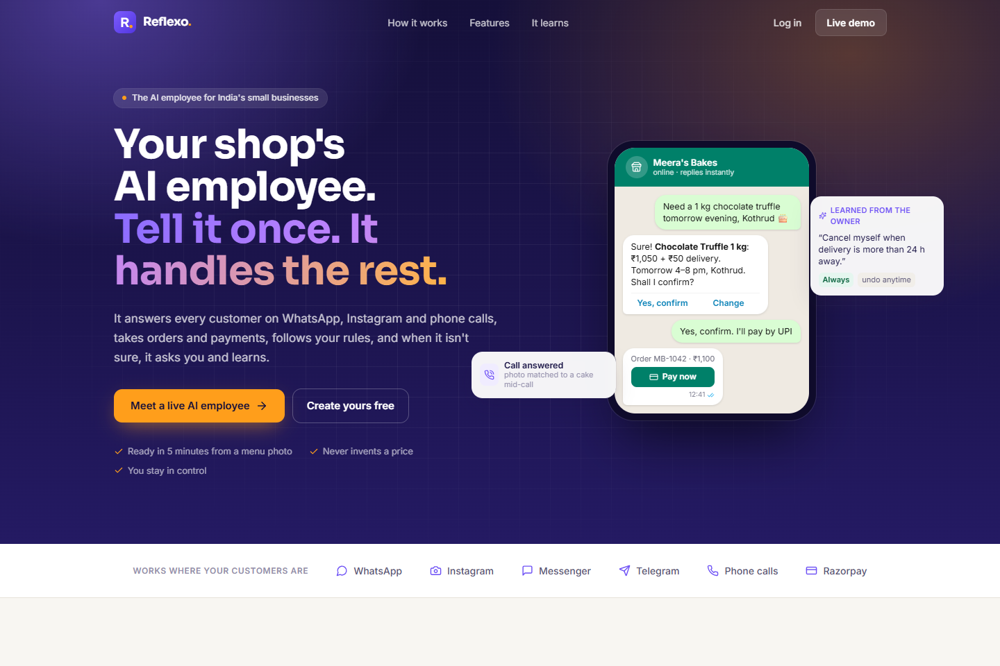
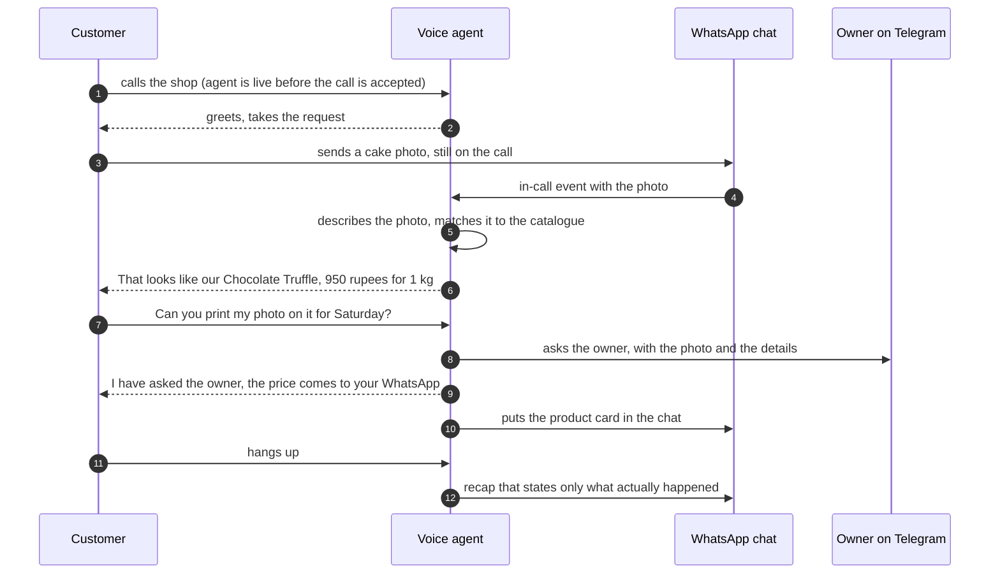
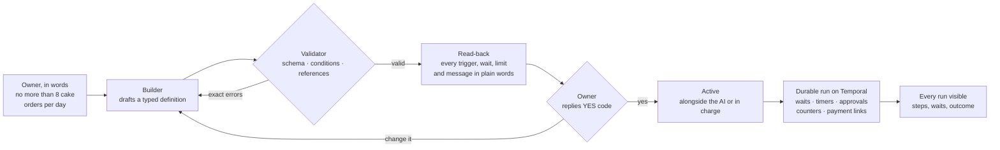
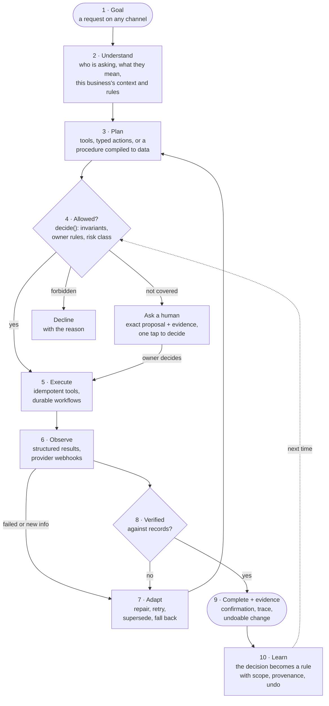
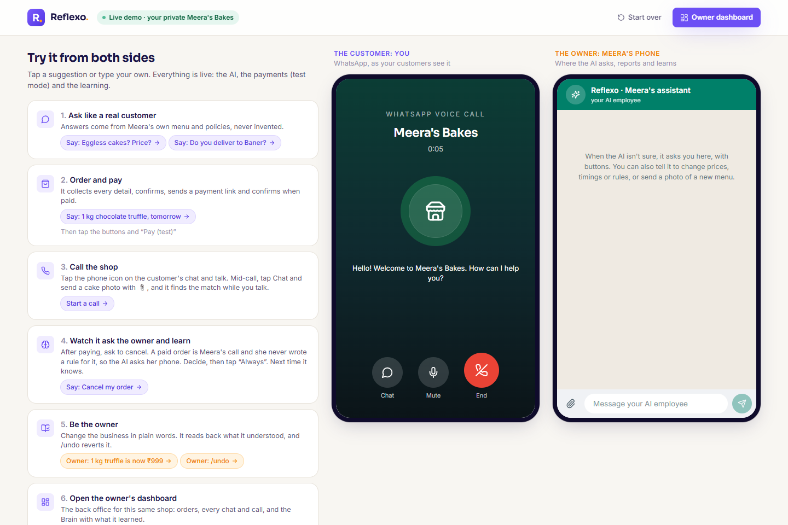
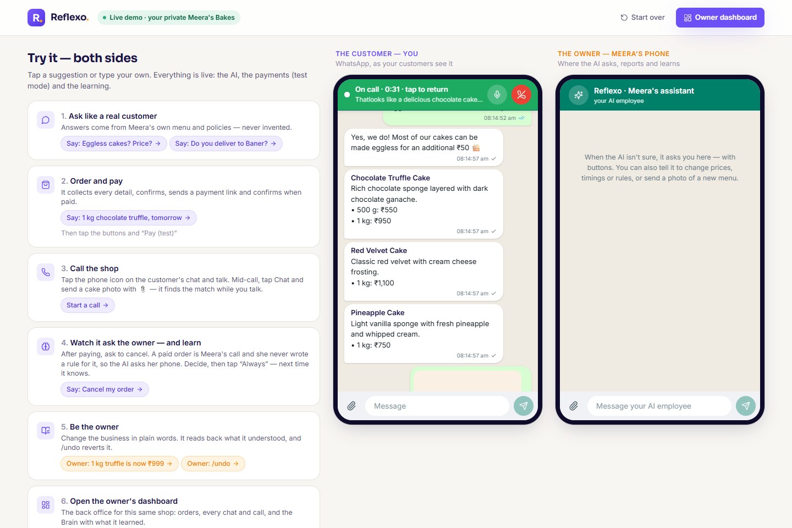
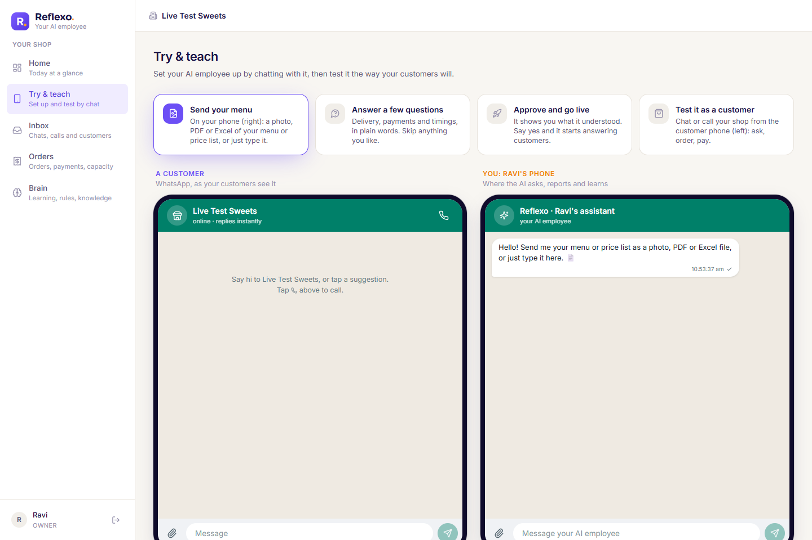
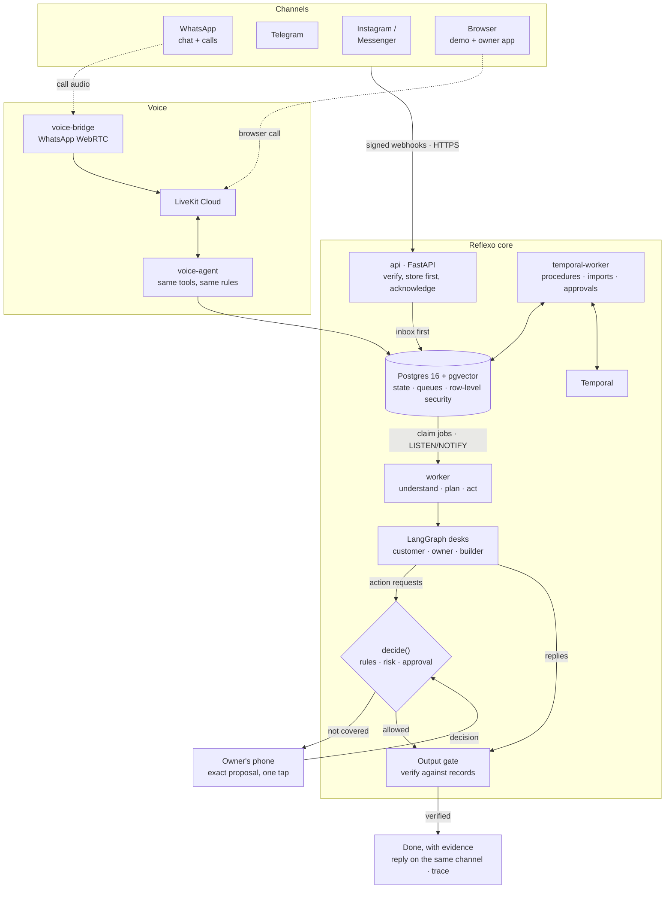

# Reflexo: an AI employee that turns requests into completed, verified work

**Live:** [reflexo.holoncode.in](https://reflexo.holoncode.in) · **Try it, no sign-up:** [/demo](https://reflexo.holoncode.in/demo) · **Hire one for your own business:** [/signup](https://reflexo.holoncode.in/signup)

Most "AI assistants" stop at an answer. Reflexo is built to **finish the work**: it takes a short request from a
customer or the owner, works out what that means for *this* business, plans the steps, uses real tools to do them,
watches what happens, recovers when something fails, asks a human only when it should, **verifies the outcome
against facts**, and leaves evidence of what it did. Then it learns, so the next request needs less supervision.

The first job it was hired for is running the front office of small businesses: selling, taking payments, handling
cancellations and refunds, answering calls, and running the owner's procedures, across WhatsApp, Telegram,
Messenger, Instagram and voice. That narrow job is deliberately real: deployed, multi-tenant, on real channels,
real payments and real phone calls, so its autonomy can be tested rather than imagined.



---

## What is hard to copy

Plenty of products can answer a chat. Two things here took most of the engineering and are what make the employee
genuinely useful: **a phone call and a chat that behave as one live conversation**, and **procedures the owner
writes in plain words that are checked before they run and then run reliably for days**.

### 1. Voice and chat as one conversation, in real time

A customer calls the shop on WhatsApp (or from a browser). While they are talking, they can send a photo, an
address or their location in the chat, and the voice agent reacts to it **during the call**.



What makes this work, and work safely:

| | |
|---|---|
| **One brain** | The voice agent uses the same tools, rules, decision function and grounding as chat. Voice is a channel, not a second bot that can drift |
| **The chat feeds the call** | Photos are described and matched to the catalogue while the caller talks; typed text counts as speech (addresses, spellings); a shared location becomes the delivery address and gets a delivery quote |
| **The call feeds the chat** | The agent can put a product card, an order summary or a payment link into the chat mid-call, or ask for a photo and wait for it |
| **No invented prices, even spoken** | Every spoken sentence passes a price gate before text-to-speech; a sentence with an unverified amount is replaced |
| **Promises are reconciled** | When the call ends, everything the agent said it would do is checked against what actually happened; anything unbacked becomes an owner question, and the recap states only facts |
| **Nothing falls between call and chat** | A message sent as the caller hangs up goes back to the chat AI; routing locks the call so it is answered exactly once |
| **Real infrastructure** | WhatsApp calls over WebRTC (Meta's SDP rules; the call is accepted only once the agent's audio is live, so the caller never hears silence), browser calls over LiveKit with captions; measured ready-to-talk time on the live site: 4 to 6 seconds |

### 2. Procedures written in words, tested before they run, run reliably

The owner types something like *"remind customers a day before delivery"* or *"no more than 8 cake orders per
day, offer the next free date"*. That becomes a working procedure, through a pipeline that never lets an unchecked
plan run:



| | |
|---|---|
| **Plans are data, not prompts** | A definition is typed: 12 triggers (message received, order confirming, payment captured, a schedule, ...) and 15 step types (send, wait, wait for an event, approval, branch, counter limit, payment link, classify, generate, update order, notify owner, deny, ...). Conditions are CEL expressions; nothing is ever `eval`'d |
| **Checked before they exist** | The validator checks the schema, the conditions and every reference; its exact errors go back to the builder for up to two repair rounds |
| **Understood before they run** | A deterministic read-back states every limit, wait and message in the owner's words; nothing runs until the owner confirms with a code |
| **Guards act in real time** | A guard runs inside order confirmation: when Saturday is full it declines with the reason, offers the next free dates, and releases the slot if an order is cancelled or a payment link expires |
| **Run reliably for days** | Each run is a Temporal workflow: a reminder scheduled for tomorrow survives restarts and deploys; approvals wait for the owner; counters are exact |
| **Easy to test** | A demo time scale (one day becomes one minute) lets a multi-day procedure run in front of you; runs can be paused, resumed and fast-forwarded past a wait; new procedures start in observe mode beside the AI before taking charge; an eval suite checks that owner descriptions become valid procedures (8 of 8), and integration tests run them on a real Temporal server |
| **The AI knows about them** | The customer-facing AI sees the procedures that apply, so it never contradicts the owner's own automation |

---

## The core loop, implemented



A concrete run, from the live demo: a customer writes *"Please cancel my order, my plans have changed."*

1. **Understand.** The message is resolved to a known customer with one paid order for tomorrow; the shop's rules
   and everything open with this customer are in context.
2. **Plan.** Cancel order MB-1042 (a typed capability: `order.cancel`, risk class *commitment*).
3. **Decide.** Invariants pass (not yet delivered). No owner rule covers a *paid* order. Default for the risk class:
   propose, don't act.
4. **Ask.** The owner's phone receives the exact action with a two-line brief and buttons. The customer is told
   it is being checked (and nothing is promised that wasn't done).
5. **Execute.** The owner taps *Yes*: the cancellation runs exactly as proposed, once (idempotent), and the
   customer is told.
6. **Learn.** The owner taps *Always*: the decision becomes a rule ("cancel myself when delivery is more than
   24 h away"), read back for confirmation, stored with its source and an undo.
7. **Next time.** The same request is decided and completed without the owner; the owner gets a note citing the
   rule used. Autonomy grew because trust was earned, not assumed.

---

## What the brief asks for, and where it lives in the code

| The brief asks for | How Reflexo does it | Where |
|---|---|---|
| **Understanding the intended outcome** | Identity and role first (customer, owner, team; owners only via verified bindings). Then context assembly: the business profile, the catalogue cards most likely needed, open orders, customer memory, the owner's rules, the language | `gateway/identity.py`, `agent/context.py` |
| **Determining what needs to be done** | Requests map to typed **capabilities** with invariants and a risk class, never to ad-hoc prompt logic | `agent/capabilities.py` |
| **Planning the required actions** | A LangGraph loop plans tool calls step by step. Multi-step procedures ("remind customers a day before delivery") are compiled by a builder into a **validated, deterministic plan as data**, read back to the owner before it can run. Menu imports produce a change plan before anything is applied | `agent/graphs/customer.py`, `agent/owner_desk.py`, `automations/builder.py`, `automations/validator.py`, `knowledge/imports.py` |
| **Selecting appropriate tools** | A typed tool registry per role ("desk") with permission scopes; channel-agnostic content blocks so the plan never depends on the channel | `agent/tools/base.py`, `gateway/manifests.py` |
| **Executing actions** | Side-effecting tools run behind idempotency keys (safe to retry); waiting and multi-step work run as durable Temporal workflows; payments, sends and calls go through real providers | `agent/tools/`, `workflows/automation_run.py`, `commerce/payments.py`, `gateway/outbound.py` |
| **Observing what happened** | Every tool returns `{"ok", "data"}` or a typed error with **guidance**; provider webhooks (payment captured, delivery status, call events) come back as events; every stage of every request is recorded | `agent/tools/base.py`, `integrations/razorpay.py`, `common/xray.py` |
| **Choosing the next action from the result** | The model sees structured results and guidance and re-plans; a newer customer message **supersedes** a running plan before it can act on stale information | `agent/graphs/customer.py`, `pipeline/turns.py` |
| **Recovering from failures** | Repair rounds with exact guidance, model fallback, queue leases that survive a crashed worker, holding replies instead of silence, Temporal retries, unanswered in-call messages handed back to chat. A chaos lab breaks things on purpose and **computes** whether the system recovered | `agent/model_gateway/gateway.py`, `pipeline/worker.py`, `voice/call_events.py`, `admin/chaos.py` |
| **Maintaining state and context** | Postgres as the single source of truth (and the queue); per-turn agent state checkpointed; customer facts remembered; the playbook (facts, rules, procedures) is long-term memory the owner can read and undo | `agent/checkpointer.py`, `knowledge/playbook.py`, `knowledge/changesets.py` |
| **Asking for human input or approval** | `decide()` turns anything uncovered into a proposal with the exact action and evidence (including photos the customer sent); approvals carry short codes; a person can take over a conversation and hand it back | `agent/proposals.py`, `agent/questions.py`, `approvals/`, `owner/commands.py` |
| **Verifying the outcome was completed** | A deterministic **output gate** checks every price, discount, link and promise against records before anything is sent; an order counts as paid only when the payment provider's signed webhook says so; imported prices must appear in the source; automations are validated and read back; at the end of a call every promise is **reconciled against what actually happened** | `agent/output_gate.py`, `agent/grounding.py`, `automations/readback.py`, `voice/summary.py` |
| **Returning evidence or a useful summary** | Confirmations to the customer; owner notes that cite the rule used; call recaps that state only facts; every change as an undoable change set with its provenance; a full trace of every request (model, tools, checks, timings) in the ops console | `agent/proposals.py`, `voice/summary.py`, `knowledge/changesets.py`, X-ray in `/admin` |

---

## Built to grow: horizontally and vertically

The shop is the first employer, not the limit. Everything specific to a business is **data the owner teaches**,
and everything specific to a channel or provider sits behind an adapter. That is what makes the same employee
reusable for very different kinds of work.

### Horizontally: any channel, any business, any system

| Dimension | How it extends | Proven today |
|---|---|---|
| **Channels** | A channel is an adapter plus a capability manifest (what it can render). Agents speak in channel-agnostic content blocks; the gateway renders and degrades them per channel. Voice is a channel, not a separate brain | WhatsApp chat and calls, Telegram, Messenger, Instagram DMs and comments, browser voice calls, a web phone simulator |
| **Businesses** | Strict multi-tenancy with Postgres row-level security. A new business is set up **by chat**: send a menu photo, PDF, spreadsheet or typed list; answer a few questions; approve a preview; go live | A bakery and a sweet shop set up from scratch in about 80 seconds; every demo visitor gets a private business |
| **Systems and integrations** | Integrations sit behind ports and typed tools; their events come back into the same loop | Razorpay payments (links, signed webhooks, reconciliation) |
| **Languages** | One policy setting drives the reply language; understanding works across English, Hindi and Hinglish | English-only policy live; mirror mode tested |

### Vertically: deeper work and more autonomy

| Lever | How it deepens |
|---|---|
| **New actions** | Register a typed capability with its invariants and risk class. It immediately inherits the decision function, proposals to the owner, learning, approvals, evidence and undo, with no new flow to write |
| **New procedures** | The owner describes a routine in plain words; it is compiled into a validated definition with conditions (CEL), durable waits, counters and approvals, read back, and run by Temporal |
| **Earned autonomy** | Each capability has an autonomy level (act, propose, never). It starts from the risk class and moves with the owner's decisions, so the employee takes on more as trust grows, and every autonomous action traces back to a human decision |
| **Knowledge** | Facts, rules and procedures are versioned, scoped (everyone or one customer) and undoable, so teaching is safe |

---

## Guardrails as policy-as-code: what the employee learns, enforced by an open policy engine

A powerful employee needs boundaries it cannot talk its way around. In Reflexo the model **never decides whether
it is allowed to act**: it can only request a typed action, and a deterministic decision function answers. What the
owner teaches is stored the same way, which is what lets it move into a standard, open-source policy engine.

**What a learned rule already is.** Not text in a prompt, but a typed record: a capability (`order.cancel`), an
effect (`allow`, `deny` or `propose`), conditions over a fixed catalogue of fields with typed operators
(`order.status in [...]`, `order.hours_until_delivery > 24`, `order.total_rupees <= 2000`, ...), a scope (everyone
or one customer), its provenance (which owner decision created it) and an undo. On conflict the safest effect
wins (deny over propose over allow). It was designed as a closed condition language precisely so it compiles
without loss.

**The same rule, compiled for [Cedar](https://www.cedarpolicy.com/)** (or Rego for
[Open Policy Agent](https://www.openpolicyagent.org/); [Cerbos](https://www.cerbos.dev/) and
[Casbin](https://casbin.org/) fit the same shape). The owner taught, by tapping *Always*: *"cancel myself when
delivery is more than 24 hours away and the order is confirmed."*

```cedar
// Owner-taught rule (provenance: decision on order MB-1042, revertible with /undo)
permit (
  principal == Reflexo::Employee::"meeras-bakes",
  action    == Reflexo::Action::"order.cancel",
  resource is Reflexo::Order
) when {
  resource.business == principal.business &&
  resource.status == "confirmed" &&
  context.hours_until_delivery > 24
};

// Platform guardrails: forbid always beats permit, whatever was learned
forbid (principal, action == Reflexo::Action::"order.cancel", resource)
  when { resource.status == "delivered" };                       // hard invariant
forbid (principal, action, resource)
  when { resource.business != principal.business };              // tenant isolation
forbid (principal, action == Reflexo::Action::"refund.request", resource)
  when { context.amount_rupees > 2000 && !context.owner_approved };
```

The three outcomes of `decide()` map onto the engine's two, with one convention: **explicit `forbid` means
decline, explicit `permit` means act, and "not permitted" means propose to the owner**. An owner's approval comes
back as `context.owner_approved == true`, which a platform policy permits, while every platform `forbid` still
applies. In Rego the same rule returns a decision document (`{"effect": "allow", "rule": "...", "reasons": [...]}`)
that the employee logs as evidence.

**Why this gives the employee real power, safely**

| | |
|---|---|
| **Separation of duties** | The model proposes actions; the policy engine disposes. A prompt injection or a confused model can request anything but cannot grant itself permission |
| **Layered authority** | Platform guardrails (`forbid`) sit above owner-taught rules (`permit`), which sit above defaults by risk class. A learned rule can never override a platform limit |
| **Reviewable and testable** | Policies are versioned files: diffed in review, unit-tested in CI ("no rule permits refunds above ₹2,000 without approval"), and with Cedar, checked by automated reasoning for conflicts and gaps before deployment |
| **One gate for every way of acting** | The same check guards an API call today and a browser or desktop action tomorrow: "submit the refund form" is just another action on a resource |
| **Auditable** | Every decision records which policy allowed or forbade it, next to the trace of what the employee did |
| **Portable learning** | What one business teaches is plain policy that can be inspected, exported, or offered to similar businesses as a starting template |

**Status:** the typed rule model, the deterministic `decide()` with these precedence semantics, proposals,
learning, read-backs and undo are implemented and tested (`knowledge/playbook.py`, `agent/capabilities.py`).
Compiling rules to Cedar or Rego and evaluating them in the engine is the designed next step; the rule language
was kept closed so that compilation is a straight translation, not a rewrite.

---

## Why it can be trusted with real work

| | |
|---|---|
| **Never invents** | The gate is code, not a prompt. On an adversarial suite, 38 of 38 invented prices, discounts and links were blocked; on a grounding suite, 20 of 20 real answers passed |
| **Never authorises itself** | Consequential actions go through `decide()`; the model cannot skip it |
| **Never loses work** | Inbox-first ingestion, idempotent handlers, durable workflows; a killed worker resumes and sends once |
| **Measured, not claimed** | 612 automated tests; 8 evaluation suites against the real model, all above threshold (tool choice 40/40, grounding 20/20, language 20/20, adversarial gate 38/38, owner-answer scope 15/15, owner commands 14/15, automation builder 8/8, learning 8/8) |
| **Observable** | Every request is a timeline: stages, model, tools, the gate's verdict, durations |

Details: [docs/QUALITY.md](docs/QUALITY.md).

---

## Easy to use: the owner manages it by talking to it

No forms, no flow builders. The owner sets the business up, changes prices, teaches rules and creates procedures in
plain language on the phone they already use. Every change is read back before it applies and can be undone with
`/undo`. Customers just message or call.

| Voice call from the browser | Photo sent during the call | A new owner setting up by chat |
|---|---|---|
|  |  |  |

---

## Try it

| | |
|---|---|
| **Be the customer** ([/demo](https://reflexo.holoncode.in/demo)) | A private copy of a demo bakery: chat, order, pay (test mode), cancel |
| **Call it from the browser** | The same voice agent as WhatsApp calls. Mid-call, tap Chat and send a photo: it describes it and finds the match while you talk |
| **Be the owner** | The second phone is the owner's: decide what the employee proposes, teach it a rule, change prices in words |
| **Open the back office** | Orders, every chat and call, and the Brain: learned rules, procedures, knowledge, history |
| **Hire one** ([/signup](https://reflexo.holoncode.in/signup)) | Set up a new business by chatting with it |

---

## Architecture in one picture



One Python codebase (a modular monolith with enforced module boundaries) running as six processes. Full detail:
[docs/ARCHITECTURE.md](docs/ARCHITECTURE.md). Every major choice, with alternatives and measurements:
[docs/DECISIONS.md](docs/DECISIONS.md). Hosting, latency measurements and cost: [docs/DEPLOYMENT.md](docs/DEPLOYMENT.md).

---

## Honest scope, and the next step

**What this prototype does not do yet: operate browsers and desktop applications.** Today the employee acts through
APIs and messaging channels, where actions are typed and outcomes can be verified exactly.

The architecture is built for that next step. A computer-use executor (a browser or desktop driver) becomes one
more tool provider behind the same contracts: it receives a typed action, the same `decide()` governs whether it
may act or must ask, its observations (screenshots, page state) feed the same observe-adapt loop, its result is
verified against the stated outcome before the task counts as done, and its evidence lands in the same trace. The
parts that make autonomy safe (understanding, planning as data, permission, verification, evidence, learning) are
already in place and tested; a new way of acting plugs into them rather than reinventing them.

---

## Run it locally

Needs Python 3.12 with [uv](https://docs.astral.sh/uv/), Node 20 and Docker.

```bash
cp .env.example .env                       # Gemini, Deepgram, LiveKit, Razorpay test keys, ...
uv sync
uv run python tasks.py up                  # Postgres + pgvector, Redis, Temporal, Jaeger
uv run python tasks.py migrate             # schema, roles, row-level security
uv run python tasks.py demo-reset --full   # demo businesses
uv run python tasks.py admin-build         # web app: site, owner app, ops console
uv run python tasks.py api                 # http://localhost:8080
uv run python tasks.py worker              # plus: python -m reflexo.workflows.worker, tasks.py voice-agent, voice-bridge
```

Quality gates: `tasks.py lint` (ruff, boundaries, forbidden patterns), `tasks.py typecheck` (mypy strict),
`tasks.py test` (612 tests), `tasks.py eval` (8 suites against the real model).

## Repository map

| Path | What |
|---|---|
| `src/reflexo/` | One package per module: `gateway`, `pipeline`, `agent`, `voice`, `knowledge`, `commerce`, `automations`, `approvals`, `owner`, `integrations`, `workflows`, `admin`, `api`, `common` |
| `apps/admin/` | React + TypeScript: public site and demo (`/`), owner app (`/app`), ops console (`/admin`) |
| `migrations/` | Schema, roles and row-level security |
| `tests/`, `evals/` | Unit and integration tests; evaluation datasets and reports |
| `deploy/` | Production compose files and HTTPS |
| `docs/` | Architecture, decisions, deployment, quality, and the log of code harvested from the earlier codebase ([reflexo_code](https://github.com/taha-sadikot-m/reflexo_code)) |
