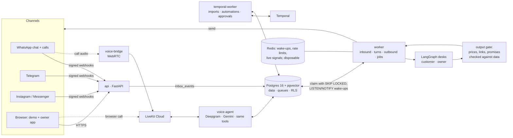

# Reflexo: an AI employee for small businesses

**Live:** [reflexo.holoncode.in](https://reflexo.holoncode.in) · **Try it, no sign-up:** [reflexo.holoncode.in/demo](https://reflexo.holoncode.in/demo) · **Create your own shop:** [/signup](https://reflexo.holoncode.in/signup)

Reflexo answers a shop's customers on WhatsApp, Telegram, Messenger, Instagram and phone calls. It takes orders and
payments, follows the owner's rules, and when it meets something it has not been taught, it asks the owner, does
exactly what the owner decides, and offers to remember it as a rule. Every price, policy and promise it sends is
checked against the shop's own data first.

This repository is the working proof of concept: about 31,000 lines of typed Python, 7,000 lines of TypeScript,
612 automated tests and 8 evaluation suites that run against the real model. It is deployed and running.


## What you can do on the live site

| | |
|---|---|
| **Be the customer** ([/demo](https://reflexo.holoncode.in/demo)) | Every visitor gets a private copy of a demo bakery. Chat on a WhatsApp-style phone, order, pay (Razorpay test mode), cancel. |
| **Call the shop from the browser** | The same voice agent that answers WhatsApp calls, over LiveKit, with live captions. Mid-call, tap Chat and send a photo: the agent describes it and finds the matching cake while you talk. |
| **Be the owner** | The second phone is the owner's. The AI asks there with buttons when it is unsure, and learns from the answer. Change prices in plain words; `/undo` reverts. |
| **See the back office** | "Owner dashboard" opens the owner's app for the same shop: orders, every chat and call, and the Brain (learned rules, procedures, knowledge, history). |
| **Create a real shop** ([/signup](https://reflexo.holoncode.in/signup)) | Sign up, then set the shop up by chatting with it: send or type the menu, answer a few questions, approve the preview, go live. |

| Voice call from the browser | Photo sent during the call | A new owner setting up by chat |
|---|---|---|
|  |  |  |

## How it is built

One Python codebase (a modular monolith with enforced module boundaries) runs as several processes. Postgres is
the source of truth and the job queue; Temporal runs everything that waits; LangGraph runs each AI turn; a
deterministic output gate checks every message before it leaves.



Details: **[docs/ARCHITECTURE.md](docs/ARCHITECTURE.md)**: processes, modules, the life of a message, voice,
the learning loop, data model and multi-tenancy, observability.

## Decisions and why

Each significant choice, with the alternatives, the reasoning and (where it applies) the measurement that settled
it, is in **[docs/DECISIONS.md](docs/DECISIONS.md)**. A few examples:

- **The agent is a learning employee, not a set of coded flows.** No business rule (cancellations, refunds,
  discounts) is hard-coded. A deterministic `decide()` applies the owner's rules; anything uncovered becomes a
  proposal to the owner, and the decision can become a rule with a read-back and an undo.
- **Postgres as the queue.** One transactional store for data and jobs (`FOR UPDATE SKIP LOCKED`, `LISTEN/NOTIFY`)
  instead of a separate broker; Redis is optional and the system keeps working without it.
- **Every customer-visible message passes a deterministic gate.** The model can be wrong; a price, discount, link
  or promise that is not in the shop's data never reaches a customer.
- **The database lives next to the app.** Measured: a database ~180 ms away made a chat reply take ~65 s, because
  a reply makes a few hundred small queries; on the same machine it takes ~5 s.

## Deployment

Live on one AWS EC2 `m6i.large` (Stockholm) with Docker Compose and Caddy (automatic HTTPS), Postgres on the same
machine, Temporal on its own server, LiveKit Cloud for real-time audio. The region, sizing, managed-vs-local
database comparison and the latency measurements behind them are in **[docs/DEPLOYMENT.md](docs/DEPLOYMENT.md)**.

## Quality

```bash
uv run python tasks.py lint        # ruff, format, module boundaries, forbidden patterns
uv run python tasks.py typecheck   # mypy --strict
uv run python tasks.py test        # 612 unit + integration tests (integration uses real Postgres via Docker)
uv run python tasks.py eval        # 8 suites against the real model (tool choice, grounding, language, ...)
```

How the system is tested, the evaluation thresholds and results, and the production bugs found by driving the
product end to end (each fixed at the root, with a regression test): **[docs/QUALITY.md](docs/QUALITY.md)**.

## Run it locally

Needs Python 3.12 with [uv](https://docs.astral.sh/uv/), Node 20 and Docker.

```bash
cp .env.example .env                       # fill in the keys you have (Gemini, Deepgram, LiveKit, Razorpay test, ...)
uv sync
uv run python tasks.py up                  # Postgres + pgvector, Redis, Temporal, Jaeger
uv run python tasks.py migrate             # schema, roles, row-level security
uv run python tasks.py demo-reset --full   # demo shops with their catalogues
uv run python tasks.py admin-build         # build the web app (site, owner app, ops console)
uv run python tasks.py api                 # http://localhost:8080
uv run python tasks.py worker              # in a second terminal (and temporal worker / voice as needed)
```

`make <task>` wraps the same commands on Linux and macOS.

## Repository map

| Path | What |
|---|---|
| `src/reflexo/` | The application: one package per module (`gateway`, `pipeline`, `agent`, `voice`, `knowledge`, `commerce`, `automations`, `approvals`, `owner`, `integrations`, `workflows`, `admin`, `api`, `common`) |
| `apps/admin/` | React + TypeScript web app: public site and demo (`/`), owner app (`/app`), ops console (`/admin`) |
| `migrations/` | Alembic migrations (raw SQL), including roles and row-level security |
| `tests/` | Unit and integration tests; `tests/live` runs against real providers on demand |
| `evals/` | Evaluation datasets and reports |
| `deploy/` | Production compose files, Caddy config, Postgres roles |
| `config/seeds/` | Demo businesses |
| `docs/` | Architecture, decisions, deployment, quality |
