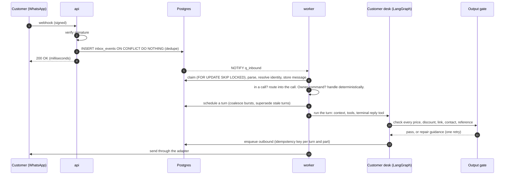
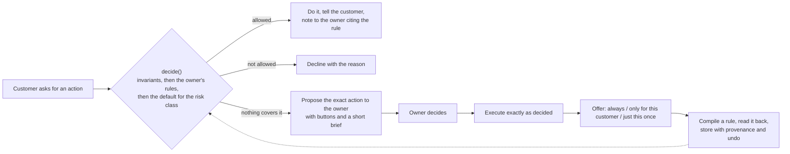
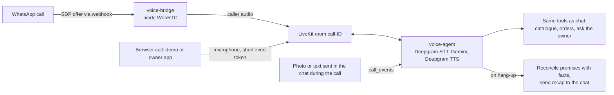

# Architecture

Reflexo is one Python 3.12 codebase, a **modular monolith**, deployed as several processes. Modules talk through
typed in-process interfaces, never internal HTTP. The design goal is that every part of the system is correct
under retries, restarts and partial failure, and that every customer-visible word can be traced back to data.

## 1. Processes

| Process | Entry point | What it does |
|---|---|---|
| `api` | `reflexo.api.main:app` (FastAPI) | Webhook ingress (verify signature, insert into `inbox_events`, acknowledge in milliseconds); public site and demo; owner and operator APIs; X-ray live stream (SSE); serves the web app |
| `worker` | `reflexo.pipeline.worker` | Four pools on Postgres queues: `inbound` (parse, identify, persist, route), `turns` (AI turns), `outbound` (send through channel adapters), `jobs` (media, embeddings, timers) |
| `temporal-worker` | `reflexo.workflows.worker` | Durable workflows: menu imports, onboarding preview, automation building and runs, approvals that wait |
| `voice-bridge` | `reflexo.voice.bridge_worker` | Owns live WhatsApp calls: WebRTC (aiortc) to Meta on one side, a LiveKit room on the other |
| `voice-agent` | `reflexo.voice.agent_worker` | LiveKit Agents worker: Deepgram speech-to-text and text-to-speech, Gemini, the same tools as the chat desks |
| `caddy` | `deploy/Caddyfile` | HTTPS with automatic certificates, reverse proxy, redirects from earlier addresses |

Infrastructure: Postgres 16 with pgvector, Redis 7, Temporal, LiveKit Cloud. AI: Gemini (`gemini-2.5-flash`,
fallback `gemini-2.5-flash-lite`, embeddings `gemini-embedding-001`), Deepgram `nova-3` and Aura TTS.

## 2. Modules and boundaries

`src/reflexo/<module>/api.py` is the only thing another module may import. `scripts/check_boundaries.py` fails the
build on any other import, and on dependencies the table below does not allow. Cycles are broken with **ports**
(typed interfaces registered at start-up, for example `TurnRunnerPort`, `CallRouterPort`, `OwnerNotifyPort`).

| Module | Responsibility |
|---|---|
| `common` | Settings, ids (UUIDv7), money in paise, time and demo time scale, database sessions and tenancy, logging, tracing, ports, the X-ray event emitter, language policy |
| `pipeline` | Queue mechanics, worker runtime, turn scheduling (coalescing, supersession), jobs |
| `gateway` | Channel adapters (WhatsApp, Messenger, Instagram, Telegram, simulator), signature checks, normalisation, identity, conversations and messages, rendering content blocks per channel, outbound sending, channel policy (24-hour window, opt-out) |
| `agent` | LangGraph desks (customer, owner, automation builder), context assembly, tools, the output gate, capabilities and the decision function, ask-the-owner, the model gateway |
| `voice` | Call sessions, the WhatsApp WebRTC bridge, browser calls, the LiveKit agent, in-call chat events, end-of-call reconciliation |
| `knowledge` | Business profile, catalogue (offerings and variants), Q&A, playbook rules, change sets with undo, hybrid search (full text + pgvector), menu import |
| `commerce` | Orders, payment links (Razorpay), cash-on-delivery rules, order events |
| `automations` | Automation definitions, CEL expressions (no `eval`), validator, read-back, router, guards, Temporal interpreter |
| `approvals` | Approval requests with short codes, decisions, Temporal signals |
| `owner` | Owner timeline, file library, notifications, onboarding, deterministic owner commands (`/undo`, `YES 1234`) |
| `integrations` | Razorpay client and webhook |
| `workflows` | Temporal worker bootstrap and registry |
| `admin` | Operator and owner APIs, the public demo (sandboxes), accounts, X-ray, simulation lab, chaos, evals |
| `api` | HTTP routes only |

## 3. The life of a message

Key properties:

- **Inbox first.** A webhook is stored before anything else happens, so a crash never loses a message and a
  provider's retry is deduplicated.
- **Every step is idempotent.** Queue handlers, activities and side-effecting tools use keys such as
  `turn:{turn_id}:{step}:{i}`; running anything twice is safe.
- **Turns coalesce and supersede.** Messages that arrive together are answered together; a turn overtaken by a
  newer message checks a flag before each model call, tool and send, and never sends a stale answer.
- **Holding replies.** If a turn is slow, the customer gets a short holding message instead of silence.

## 4. The agent

Each turn is a LangGraph `StateGraph` (a "desk"). The **customer desk** answers customers; the **owner desk** runs
the back office in plain language (prices, rules, imports, automations); the **builder** turns an owner's
description into an automation definition.

- **Context** is assembled per turn: the business profile, the cards most likely needed (speculative retrieval),
  the open order, everything the shop has open with this customer, and the rules that apply.
- **Tools** return `{"ok": true, "data": ...}` or a typed error with guidance; the model can recover from guidance.
- **The reply is a tool call**, validated by a schema (`AgentOutput`). Its content is a list of channel-agnostic
  content blocks (text, product card, buttons, payment link); the gateway renders them per channel and degrades
  gracefully (carousel to list to numbered text).
- **The output gate** is deterministic code, not a prompt. It checks references, amounts, discounts, links,
  contacts and grounding against the shop's records and the tool results of this turn. A failed check gets one
  repair round with exact guidance; a second failure falls back to asking the owner. Measured on an adversarial
  suite: 100% of invented prices and discounts blocked.

### The learning employee

No business flow is coded. The system has **capabilities** (typed actions such as `order.cancel`, `order.change`,
`refund.request`) with hard invariants only (a delivered order cannot be cancelled) and a risk class.

The model never authorises itself: every autonomous action traces back to an owner decision or an owner rule.

## 5. Voice

- **One brain.** Voice is a channel, not a separate agent: the same tools, rules and grounding as chat.
- **Browser calls** reuse everything after the bridge: the server creates the call session, the room and an
  explicit agent dispatch, and hands the browser a token for that one room.
- **In-call chat.** A photo sent in the chat during a call goes to the voice agent, which describes it and
  matches it to the catalogue while talking. Messages the call never answered go back to the chat AI when the
  call ends; the routing locks the call row so nothing falls between the two.
- **Promises are reconciled.** At the end of a call, anything the agent said it would do is checked against what
  actually happened; anything unbacked becomes an owner question, and the recap states only facts.

## 6. Data and multi-tenancy

- **55 tables**, all with row-level security. Every tenant table carries `business_id` and a policy
  `business_id = current_setting('app.current_business_id')`; every transaction sets it.
- **Two database roles.** `reflexo_app` (forced RLS) for tenant work; `reflexo_service` for steps before a tenant
  is known (webhook routing, identity, queue claims). Migrations run as the owner role. A test asserts that every
  table with a `business_id` has a tenant policy, and that the app role without a tenant sees nothing.
- **Money** is integer paise. **Time** is UTC in the database, Asia/Kolkata for the business. **IDs** are UUIDv7.
- **Knowledge changes are change sets**: every change (an owner's words, an imported menu, a learned rule) is one
  undoable step with its provenance.

## 7. The web app

One React + TypeScript build serves three surfaces by path:

| Path | Who | What |
|---|---|---|
| `/`, `/demo`, `/signup`, `/login` | Visitors | Landing page; the live demo (a private sandbox shop per visitor); sign-up and log-in |
| `/app` | Shop owners | Their shop only: home, "Try & teach" (set up and test by chat), inbox, orders, Brain |
| `/admin` | The operator | Every shop, plus engineering tools: X-ray traces, simulation lab, chaos tests, evals, settings |

Owners and the operator use separate cookies; an owner session is locked to its business on the server, and the
engineering endpoints are operator-only. Public endpoints (demo, sign-up) are rate-limited per client and per day.

## 8. Observability

- **X-ray.** Every stage of every message (`ingress`, `identity`, `turn_started`, `model_call`, `tool_call`,
  `gate`, `sent`, ...) is a row in `pipeline_events`, streamed live to the ops console and shown as a timeline
  with durations, the model used and the gate result.
- **Tracing.** One OpenTelemetry trace per inbound event, carried across queue hops, Temporal and the voice agent.
- **Logs.** Structured JSON; phone numbers masked to the last four digits; secrets never logged.

## 9. House rules enforced in code

| Rule | Where |
|---|---|
| English everywhere the AI writes or speaks (it still understands Hindi and Hinglish) | `language_policy` setting; prompts get their language rule from it; system text uses `fixed()` |
| No long em-dash in anything a person reads | Outgoing messages and voice are normalised (`gateway.plain_punctuation`); the web app normalises API text; guard tests over sources |
| No `eval`/`exec`, no forbidden legacy names | `scripts/check_guards.py` |
| Module boundaries | `scripts/check_boundaries.py` |
| Weak secrets refuse to start outside development | settings validation |
