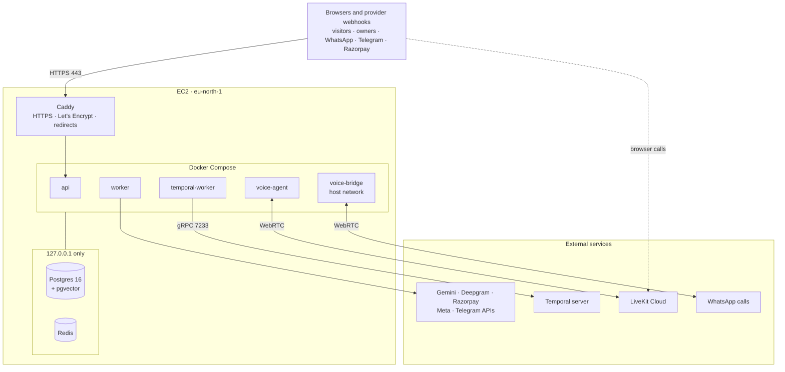

# Deployment

**Live:** https://reflexo.holoncode.in

## Topology



| Component | Where | Why there |
|---|---|---|
| App (api, workers, voice) | EC2 `m6i.large`, Stockholm, Docker Compose | One machine is enough for a POC; Compose keeps the whole system in one reproducible file |
| Postgres | Same machine, Docker volume | The app makes a few hundred queries per reply; it must be close (see below) |
| Redis | Same machine | Disposable real-time layer; never needs to leave the box |
| Temporal | Its own server | Already running; only background work (imports, automations) talks to it |
| Real-time audio | LiveKit Cloud | Media servers close to callers, no UDP ports to open on our server |
| HTTPS | Caddy | Automatic certificates and renewals, HTTP/2 and HTTP/3 |
| DNS | `reflexo` A record at the domain registrar | The old `<ip>.sslip.io` address redirects to the domain |

## The latency measurements that decided it

Round trips measured from the server (TCP connect, best of six):

| Destination | Round trip |
|---|---|
| Gemini API | ~2 ms |
| LiveKit Cloud | ~23 ms |
| Temporal server | ~102 ms |
| Deepgram | ~161 ms |
| Managed Postgres (Neon, Singapore) | ~181 ms |
| Postgres on the same machine | under 1 ms |

End-to-end, measured on the live site from outside (three demo messages; a browser call with a fake microphone):

| Database | Chat reply | Voice call ready to talk |
|---|---|---|
| Neon, Singapore | 62 to 73 s | 20+ s |
| Postgres on the server | 4.3 to 8.6 s | 3.9 to 6.3 s |

The model and speech services are fast; what hurt was the database, because round-trip time multiplies by the
number of queries per reply. Temporal at ~100 ms is fine: chat replies never wait on it, and an import's few extra
seconds are invisible.

**Rule:** the database is always in the same region as the app. A managed database is the right production move,
in the app's region, and it is a configuration change: the Neon database was set up and verified end to end
(roles, row-level security, LISTEN, the LangGraph store) before the decision was made.

## Sizing and cost

| | |
|---|---|
| Instance | `m6i.large`: 2 vCPU, 8 GB, x86_64 |
| Disk | 30 GB gp3 (image 2.2 GB, database and media well under 1 GB) |
| Memory in use | about 1.5 GB at rest; voice-agent processes are the largest |
| Not chosen | `t3`/`t4g` (CPU credits run out during calls), ARM (image built and tested on x86), larger sizes (not needed without database and Temporal on the box) |
| Cost | roughly $35 to $45 for two weeks running continuously; stopped, only disk and IP are billed |

## Security

| Area | Setting |
|---|---|
| Inbound | 22 (SSH) from one IP; 80 and 443 from anywhere. Nothing else; voice needs no inbound UDP (LiveKit Cloud and outbound WebRTC) |
| Internal services | Postgres and Redis bound to 127.0.0.1 |
| Secrets | Only in `/opt/reflexo/.env` (permissions 600); never logged, committed or built into the image; settings refuse weak secrets outside development |
| Webhooks | Signature checked on every provider webhook before anything is stored |
| Sessions | Operator and owner sessions are signed cookies with CSRF tokens; owners are locked to their own business |
| Public endpoints | Demo shops and sign-ups are rate-limited per client and capped per day |
| Voice | The server's agent has its own LiveKit name, so calls never reach a developer machine |

## Runbook

**First deploy** (Ubuntu, Docker and Compose installed):

```bash
# from a workstation
git archive --format=tar HEAD | ssh ubuntu@<server> 'mkdir -p /opt/reflexo && tar -x -C /opt/reflexo'
scp .env.production ubuntu@<server>:/opt/reflexo/.env          # chmod 600 on the server

# on the server
cd /opt/reflexo
sudo docker compose -f deploy/docker-compose.prod.yml -f deploy/docker-compose.localdb.yml up -d --build
sudo docker compose -f deploy/docker-compose.prod.yml -f deploy/docker-compose.localdb.yml \
     exec api python scripts/seed.py reset --full                # demo shops, once
```

**Update:** copy the new code the same way and run the same `up -d --build`. Migrations run when the API starts.

**First update to the vault (beta WP-02, once):** the server must have vault keys before it starts, and the
showcase tokens move from `.env` into the vault before migration `0010` can run.

```bash
# in /opt/reflexo/.env (chmod 600), new random keys, never reused for the archive:
#   REFLEXO_VAULT_KEYS=v1:<base64 32 bytes>   REFLEXO_VAULT_ACTIVE_KEY_ID=v1
#   REFLEXO_ARCHIVE_KEYS=a1:<base64 32 bytes> REFLEXO_ARCHIVE_ACTIVE_KEY_ID=a1
sudo docker compose -f deploy/docker-compose.prod.yml -f deploy/docker-compose.localdb.yml build
sudo docker compose -f deploy/docker-compose.prod.yml -f deploy/docker-compose.localdb.yml \
     run --rm api python scripts/vault_import_env.py               # upgrades to 0009, imports, then to head
sudo docker compose -f deploy/docker-compose.prod.yml -f deploy/docker-compose.localdb.yml up -d
```

Keep a copy of the vault keys outside the server: without them no stored credential can be read.

**Privacy basics (beta WP-22a).** A deployed stack refuses to start without `REFLEXO_OPERATOR_TOTP_SECRET` (base32, for the operator's authenticator app) and with the customer notice or operator TOTP switched off. Migration `0012` adds `consent_records`, `data_requests` and `operator_access_log`. Meta's app settings point at `/privacy`, `/terms`, `/data-deletion`, `POST /meta/data-deletion` and `POST /meta/deauthorize`.

**The rule checker (beta WP-26).** The image builds `reflexo-policy-check` (Rust) and carries the cvc5 solver
(checksum pinned in the `Dockerfile`), so the first build after WP-26 takes a few minutes longer. Migration `0011`
adds `policy_sets`; the API compiles each business's rules on the first decision. On a workstation the same binary
runs through Docker: `make policy-check` builds `reflexo-policy-check:0.1.0`, and
`REFLEXO_POLICY_CHECK_CMD=docker run --rm -i reflexo-policy-check:0.1.0`.

**Domain:** add an A record for the host name pointing at the server, set `REFLEXO_DOMAIN` and
`REFLEXO_PUBLIC_BASE_URL` in `.env`, and list earlier host names in `REFLEXO_REDIRECT_FROM`. Caddy issues the
certificate on the first request.

**Provider webhooks:** WhatsApp `https://<domain>/webhooks/meta_whatsapp`; Razorpay
`https://<domain>/integrations/webhooks/razorpay`; Telegram is set with `scripts/telegram_webhook.py set https://<domain>`.

**Operations:** `docker compose ... ps`, `... logs -f <service>`; the ops console at `/admin` shows health, every
message as a traced timeline (X-ray) and a chaos lab that kills workers or Redis to prove recovery.

## What changes for production

- Managed Postgres in the app's region with point-in-time recovery; nightly logical backups to object storage.
- Two or more app instances behind a load balancer; the queue design already supports many workers.
- Secrets in a manager (AWS Secrets Manager or SSM) instead of a file; credentials for channels in an encrypted
  vault (designed: AES-256-GCM with per-business associated data).
- CI/CD: lint, type check, tests and evals on every change; images built once and promoted.
- Monitoring and alerting on queue depth, turn latency, gate failures and provider errors (all already recorded).
